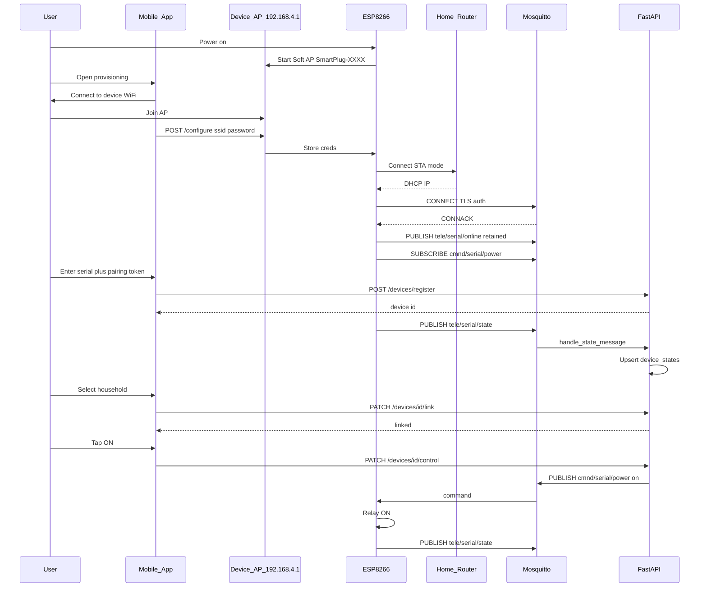

# Device Provisioning Flow (First Boot)

Step-by-step documentation for what happens when a SmartPlug powers on for the first time (or after factory reset): AP mode, WiFi configuration, MQTT connection, cloud registration, and remote control readiness.

Aligned with [architecture.md](architecture.md) §3 and the ESP8266 firmware behavior described in the product spec.

## Prerequisites

Before the customer starts:

| Requirement | Owner |
|-------------|-------|
| Factory serial burned into firmware NVS | Manufacturing |
| MQTT broker hostname + port in firmware defaults | Manufacturing / ops |
| Per-device MQTT credentials (recommended) | Manufacturing + [MQTT_SETUP.md](MQTT_SETUP.md) |
| Customer account (phone OTP) | Customer |
| Pairing token available | Ops label, app, or firmware display |
| Cloud backend + Mosquitto running | [DEPLOYMENT_GUIDE.md](DEPLOYMENT_GUIDE.md) |

## High-level flow

```
Power ON → AP Mode → User connects → WiFi creds → Join LAN → MQTT Connect
    → Publish online/state → User registers in app → Link household → Controllable
```

## Step-by-step first boot

### Step 1 — Device enters AP mode

**Trigger:** First power-on, factory reset, or no saved WiFi credentials.

**Firmware behavior:**

- ESP8266 creates soft-AP (typical SSID pattern: `SmartPlug-XXXX` where `XXXX` is derived from MAC or serial suffix)
- DHCP server on `192.168.4.1/24`
- HTTP captive portal or fixed IP web UI

**User action:** Plug into wall outlet; wait for LED pattern indicating setup mode (document per hardware manual).

### Step 2 — User connects phone to device AP

**User action:**

1. Open phone WiFi settings
2. Connect to `SmartPlug-XXXX` network
3. Accept captive portal if prompted

**Mobile app path:** `/provision/ap-setup` (`ApSetupScreen`) guides through Prepare → Connect → WiFi → Configure.

**Integrated flow** (`provisioning_provider.startApProvisioning`):

1. App calls `POST /v1/devices/pairing-token` with serial
2. App POSTs Wi-Fi + MQTT + token to device AP (`DEVICE_AP_CONFIGURE_URL`, default `http://192.168.4.1/configure`)
3. App calls `POST /v1/devices/register` with serial + token
4. User links device to household

Firmware HTTP contract (align with `mobile/lib/core/network/device_ap_client.dart`):

```
POST http://192.168.4.1/configure
Content-Type: application/json

{
  "ssid": "HomeWiFi",
  "password": "wifi-password",
  "mqtt_host": "mqtt.smartplug.example.com",
  "mqtt_port": 8883,
  "serial": "SN-2026-000001",
  "pairing_token": "optional-if-passed-to-cloud"
}
```

Exact JSON schema is **firmware-defined** — align app and firmware teams on one contract.

### Step 3 — User enters home WiFi credentials

**User action:** Enter home SSID and password in captive portal or mobile app.

**Firmware behavior:**

- Store credentials in NVS
- Tear down AP mode
- Station mode connect to home router
- Retry with backoff on failure; optionally revert to AP after timeout

### Step 4 — Device joins home WiFi

**Success indicators:**

- ESP8266 obtains DHCP address (e.g. `192.168.1.50`)
- Internet reachability check (TCP to broker or DNS lookup)

**Local-only mode:** If WAN is unreachable, device may operate against a **LAN Mosquitto** only ([architecture.md](architecture.md) §2). Cloud registration is deferred until internet returns. Events may buffer locally.

### Step 5 — Device connects to MQTT broker

**Firmware connects to cloud broker** (from [MQTT_SETUP.md](MQTT_SETUP.md)):

```
Host:     mqtt.smartplug.example.com
Port:     8883 (TLS) or 1883
Client:   smartplug-SN-2026-000001
Username: device-SN-2026-000001
Password: <factory secret>
```

**On successful CONNACK:**

1. Subscribe `cmnd/{serial}/power` (QoS 1)
2. Set LWT on `tele/{serial}/online` → `{"status":"offline"}`
3. Publish **retained** birth message:

```json
{
  "status": "online",
  "ip": "192.168.1.50",
  "mac": "AA:BB:CC:DD:EE:FF",
  "firmware_version": "2.1.0",
  "rssi": -62
}
```

4. Publish initial state to `tele/{serial}/state`:

```json
{
  "power": "off",
  "connectivity": "online",
  "last_changed_at": "2026-06-29T10:00:00Z"
}
```

### Step 6 — Backend processes MQTT (if device registered)

**If `devices.serial` exists:**

- `handle_availability_message` → updates `device_states.connectivity`, `device_network_config`, inserts `device_online` event
- Realtime WebSocket broadcast `connectivity_change`

**If serial NOT yet registered:**

- Backend logs warning and **drops** message
- No UI update until customer completes Step 7

### Step 7 — Customer registers device in app

Two paths supported by the current mobile app:

#### Path A — AP setup poll (after WiFi)

1. App polls `GET /v1/devices?linked=false` every 5s (up to 60s)
2. Expects device to appear after registration

**Important:** Polling alone does not create the device — something must call `POST /v1/devices/register` with serial + pairing token. Typical flow:

- User completes AP setup
- User is routed to claim screen OR registration happened via firmware/cloud callback (future)

#### Path B — Manual claim (recommended for current codebase)

1. User opens **Claim Device** (`/provision/claim`)
2. Enters serial (e.g. `SN-2026-000001`) and pairing token from label
3. App calls `POST /v1/devices/register`
4. On success, navigates to link screen

See [DEVICE_REGISTRATION_FLOW.md](DEVICE_REGISTRATION_FLOW.md) for token bootstrap.

### Step 8 — Link device to household

1. User selects household (or creates one)
2. App calls `PATCH /v1/devices/{id}/link`:

```json
{
  "household_id": "uuid-of-home",
  "name": "Living Room"
}
```

3. `devices.household_id` and `linked_at` set
4. `device_events` row: type `linked`

### Step 9 — Device is remotely controllable

Requirements satisfied:

- [x] Device online on MQTT
- [x] `devices` row exists with matching serial
- [x] `household_id` assigned
- [x] User has `control` permission (household member or share)

User can toggle power from dashboard; see [SERVER_ARCHITECTURE.md](SERVER_ARCHITECTURE.md) for command path.

## Provisioning sequence diagram



## pairing_tokens lifecycle

| State | Meaning |
|-------|---------|
| `pending` | Ready for `POST /devices/register` |
| `used` | Consumed; `used_at` set |
| `expired` | Past `expires_at` (treated as invalid) |

Token TTL: **24 hours** for pre-provision tokens (`POST /v1/devices/pairing-token`, `PAIRING_TOKEN_PROVISION_TTL_HOURS`). **1 hour** when created via `POST /v1/devices/{id}/pairing-token` for existing devices. Ops-inserted tokens may use custom expiry for retail packaging.

Metadata JSON may include `household_id` to auto-link on register.

## Cloud / local hybrid during provisioning

| Scenario | Behavior |
|----------|----------|
| WiFi OK, internet OK | Cloud MQTT + registration |
| WiFi OK, no internet | Local MQTT only; LAN control; queue events |
| Internet restored | Firmware reconnects cloud; uploads buffered telemetry |

See [architecture.md](architecture.md) §2 for steady-state hybrid behavior.

## Firmware ↔ backend payload contract

### `tele/{serial}/online`

```json
{
  "status": "online",
  "ip": "192.168.1.50",
  "mac": "AA:BB:CC:DD:EE:FF",
  "firmware_version": "2.1.0",
  "rssi": -65
}
```

Offline: LWT `{"status":"offline"}` or empty retained message.

### `tele/{serial}/state`

```json
{
  "power": "on",
  "connectivity": "online",
  "last_changed_at": "2026-06-29T12:00:00Z"
}
```

### `tele/{serial}/event`

```json
{
  "type": "power_on",
  "occurred_at": "2026-06-29T12:00:00Z",
  "voltage": 220.5,
  "current": 0.5
}
```

Event types: `power_on`, `power_off`, `device_online`, `device_offline`, `provisioned`, `linked`

### `cmnd/{serial}/power`

Plain text payload: `on` or `off`

## Factory reset / re-provisioning

1. User holds factory reset button (firmware-defined duration)
2. NVS WiFi credentials cleared
3. Device reboots into AP mode
4. **Cloud:** `devices` row may persist; user may need to re-link
5. **MQTT:** LWT may fire `offline` before reconnect
6. New pairing token required if previous token was `used`

## Troubleshooting

| Symptom | Cause | Fix |
|---------|-------|-----|
| Cannot see AP SSID | Not in setup mode | Power cycle; hold reset |
| Captive portal does not open | Phone DNS issue | Browse `http://192.168.4.1` manually |
| WiFi connect fails | Wrong password / 5 GHz-only SSID | ESP8266 is 2.4 GHz only |
| MQTT never connects | Firewall blocks 1883/8883 | Open ports on router; test from LAN |
| Backend logs unknown serial | Device not registered | Complete `POST /devices/register` |
| App poll times out | No register call | Use claim screen with token |
| Device online in MQTT but app offline | WebSocket / auth issue | Check JWT, `wss://` proxy |
| ACL denied | Mosquitto user mismatch | Regenerate ACL for exact serial |
| 409 on register | Already linked elsewhere | Admin unlink or factory support |

### Diagnostic commands

```bash
# On VPS — watch telemetry
mosquitto_sub -h 127.0.0.1 -u smartplug-backend -P 'PASS' -t 'tele/+/online' -v

# Backend logs
journalctl -u smartplug -f | grep -i mqtt

# DB check
psql -U smartplug -d smartplug -c "SELECT serial, household_id, linked_at FROM devices;"
```

## Multi-device provisioning in one home

Each plug is provisioned independently:

1. Repeat AP setup per device (only one AP active at a time recommended)
2. Unique serial per device → unique MQTT topics
3. Same household can link multiple devices via repeated link flow
4. Dashboard lists all via `GET /v1/devices?household_id=...`

See [SERVER_ARCHITECTURE.md](SERVER_ARCHITECTURE.md) for multi-device architecture.

## Related documents

- [DEVICE_REGISTRATION_FLOW.md](DEVICE_REGISTRATION_FLOW.md) — ownership and pairing tokens
- [MQTT_SETUP.md](MQTT_SETUP.md) — broker and device auth
- [DEPLOYMENT_GUIDE.md](DEPLOYMENT_GUIDE.md) — server-side setup
