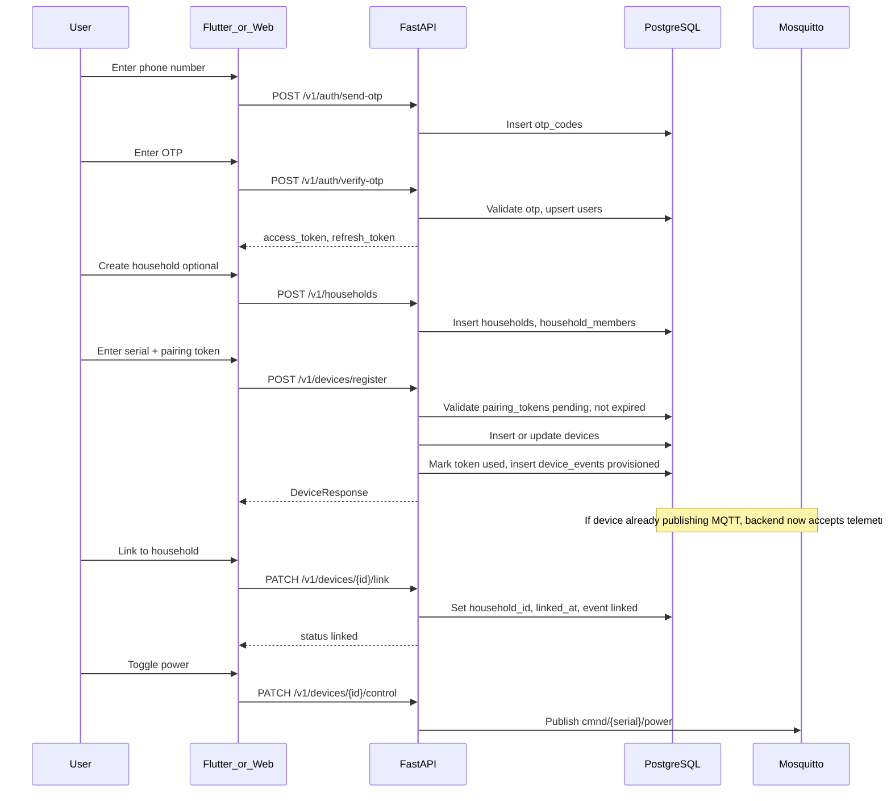

# Device Registration Flow

How physical smart plugs are linked to customer accounts in the commercial SmartPlug platform. Covers factory serials, API endpoints, database changes, access control, and sharing.

## Commercial ownership model

```
Customer (User, phone E.164)
    └── Household(s) — logical home / site
            └── Device(s) — physical plug, factory serial
                    └── SharePermission(s) — grant other phones access
```

| Role | How identified | Default permissions |
|------|----------------|---------------------|
| Household admin | `household_members.role = admin` | view, control, admin on all household devices |
| Household member | `household_members.role = member` | control on household devices |
| Sharee (device) | `share_permissions.scope = device` | view / control / admin per grant |
| Sharee (household) | `share_permissions.scope = household` | applies to all devices in household |

Only users with **control** or higher may send `PATCH /devices/{id}/control`. Only **admin** may rename, delete, or manage shares.

Implementation: `backend/app/services/access_control.py`

## Serial number policy

### Supported formats

Both formats are valid in production. The firmware string **must be identical** everywhere:

| Format | Example | Typical use |
|--------|---------|-------------|
| Commercial | `SN-2026-000001` | Factory labels, QR codes |
| Legacy / dev | `SP123456789` | API examples in `api_contract.md` |

### Rules

1. **MQTT topics** use the serial verbatim: `tele/SN-2026-000001/state`, `cmnd/SP123456789/power`
2. **Database** stores serial in `devices.serial` (`VARCHAR(50)`, unique)
3. **Mobile app** uppercases serial on claim (`claim_device_screen.dart`)
4. **Recommended regex** for validation labels:

   ```
   ^(SN-\d{4}-\d{6}|SP\d{9,})$
   ```

   Adjust batch/year segments to match your factory allocation scheme.

### Factory labeling

Each retail box should include:

- Serial number (human-readable + QR)
- Pairing code / token (or instructions to obtain via app during AP setup)
- Model (e.g. `SP-100`)
- Support URL

## Factory inventory (operational — not in application code)

There is **no** `device_inventory` or factory whitelist table in the current schema ([db_schema.md](db_schema.md)). For commercial rollout, use one of these **operations procedures**:

### Procedure A — Pre-seed devices at factory

CSV shipped from manufacturing:

```csv
serial,model,mac,manufactured_at
SN-2026-000001,SP-100,AA:BB:CC:DD:EE:01,2026-01-15
SN-2026-000002,SP-100,AA:BB:CC:DD:EE:02,2026-01-15
```

Import before devices reach customers:

```sql
-- deploy/scripts/seed-serials.sql
INSERT INTO devices (id, serial, model, mac, device_type, household_id, provisioned_at, created_at, updated_at)
VALUES
  (gen_random_uuid(), 'SN-2026-000001', 'SP-100', 'AA:BB:CC:DD:EE:01', 'smart_plug', NULL, NOW(), NOW(), NOW()),
  (gen_random_uuid(), 'SN-2026-000002', 'SP-100', 'AA:BB:CC:DD:EE:02', 'smart_plug', NULL, NOW(), NOW(), NOW())
ON CONFLICT (serial) DO NOTHING;
```

Also create Mosquitto user + ACL per [MQTT_SETUP.md](MQTT_SETUP.md).

### Procedure B — Register on first customer claim

Device row is created at `POST /v1/devices/register` if serial does not exist **and** `REQUIRE_PREREGISTERED_SERIAL=false` (default). When `REQUIRE_PREREGISTERED_SERIAL=true`, registration returns **404** unless the serial was pre-seeded at factory (Procedure A). Factory validation is **pairing token** + optional strict serial gate.

Set in `backend/.env`:

```
REQUIRE_PREREGISTERED_SERIAL=false   # flexible (dev / small rollout)
REQUIRE_PREREGISTERED_SERIAL=true    # factory mode — serial must exist in DB
```

### Recommended future enhancement (not implemented)

- Table `device_inventory(serial, manufactured_at, shipped_at, revoked)` 
- API `POST /v1/devices/claim-by-serial` with factory HMAC

Document these as roadmap items only.

## Pairing token bootstrap

Registration requires a valid `pairing_tokens` row. API endpoints:

| Endpoint | Purpose |
|----------|---------|
| `POST /v1/devices/pairing-token` | **Pre-provision token** — authenticated user, no existing device required (`device_id=NULL`) |
| `POST /v1/devices/register` | Consumes token; creates/updates device |
| `POST /v1/devices/{id}/pairing-token` | Creates token for **existing device** — requires admin permission |

### Pre-provision token (app / web)

**Request** (`ProvisionPairingTokenRequest`):

```json
{
  "household_id": "uuid-or-null",
  "serial": "SN-2026-000001"
}
```

**Response `201`** — `PairingTokenResponse` with `id`, `token`, `status`, `expires_at`.

TTL defaults to **24 hours** (`PAIRING_TOKEN_PROVISION_TTL_HOURS` in `backend/.env`). Optional `payload` stores `household_id` and `serial` for auto-link and serial binding at register time.

Used by mobile AP setup, mobile/web claim flows, and `POST /devices/add` on web.

### Ops SQL insert (fallback)

For retail packaging without app connectivity, ops can still insert tokens manually:

```sql
-- deploy/scripts/insert-pairing-token.sql
-- Run after generating token in app or with openssl rand -base64 48

INSERT INTO pairing_tokens (id, device_id, token, status, expires_at, metadata, created_at, updated_at)
VALUES (
  gen_random_uuid(),
  NULL,
  'REPLACE_WITH_URL_SAFE_TOKEN',
  'pending',
  NOW() + INTERVAL '24 hours',
  '{"household_id": null}'::jsonb,
  NOW(),
  NOW()
);
```

Print token on device label or display during AP setup.

### Factory admin token (existing device)

1. Insert `devices` row at factory (Procedure A)
2. Authenticated factory admin calls `POST /v1/devices/{id}/pairing-token`
3. Token printed on packaging

**Production pattern:** App generates token **before** sending WiFi credentials during AP setup; token is passed to firmware and presented at registration ([db_schema.md](db_schema.md) `pairing_tokens` purpose).

## End-to-end registration sequence

### Customer journey

1. Customer buys plug, creates account (phone OTP)
2. Customer provisions WiFi via AP mode ([DEVICE_PROVISIONING_FLOW.md](DEVICE_PROVISIONING_FLOW.md))
3. Customer registers device with **serial + pairing token**
4. Customer links device to a household
5. Customer controls device; may share with other phone numbers

### Sequence diagram



## API reference (registration-related)

Base URL: `https://api.smartplug.example.com/v1`  
Auth: `Authorization: Bearer <access_token>`

### Authentication

| Method | Path | Body | Response |
|--------|------|------|----------|
| POST | `/auth/send-otp` | `{"phone":"+8613800138000"}` | `expires_in_seconds`, `retry_after_seconds` |
| POST | `/auth/verify-otp` | `{"phone":"...","code":"123456"}` | `access_token`, `refresh_token`, `expires_in` |
| POST | `/auth/refresh` | `{"refresh_token":"..."}` | new `access_token` |

### Households

| Method | Path | Purpose |
|--------|------|---------|
| POST | `/households` | Create home; creator becomes admin member |
| GET | `/households` | List memberships |
| GET | `/households/{id}` | Details + device count |

### Devices

| Method | Path | Purpose |
|--------|------|---------|
| **POST** | **`/devices/pairing-token`** | **Create pre-provision pairing token** |
| **POST** | **`/devices/register`** | **Register / claim device** |
| GET | `/devices` | List accessible devices |
| GET | `/devices?linked=false` | Unlinked devices (post-provision poll) |
| PATCH | `/devices/{id}/link` | Attach to household |
| PATCH | `/devices/{id}/control` | Send command (requires control permission) |
| POST | `/devices/{id}/pairing-token` | New pairing token (admin, existing device) |
| DELETE | `/devices/{id}` | Soft-delete (admin) |

### Register request / response

**Request** (`DeviceRegisterRequest`):

```json
{
  "serial": "SN-2026-000001",
  "token": "url-safe-pairing-token-from-label-or-app",
  "name": "Living Room Plug"
}
```

**Success `201`** — `DeviceResponse` with `id`, `serial`, `name`, `household_id` (may be null), `state`, `created_at`.

**Errors:**

| Status | Condition |
|--------|-----------|
| 400 | Invalid or expired pairing token |
| 401 | Missing / invalid JWT |
| 404 | Unknown serial when `REQUIRE_PREREGISTERED_SERIAL=true` |
| 409 | Device already registered to another household |
| 422 | Validation error |

Implementation: `backend/app/routers/devices.py` → `register_device()`

### Link request

```json
{
  "household_id": "uuid",
  "name": "Kitchen Plug"
}
```

Device must have `household_id IS NULL`. Sets `linked_at`, creates `linked` event.

**409** if already linked.

### Sharing

| Method | Path | Body |
|--------|------|------|
| POST | `/shares` | `target_phone`, `scope` (`device`\|`household`), `scope_id`, `permission` (`view`\|`control`\|`admin`) |
| GET | `/shares` | Outgoing shares |
| GET | `/shares/incoming` | Pending invitations for this user |
| PATCH | `/shares/{id}` | `{"status":"accepted"}` or `declined` |
| DELETE | `/shares/{id}` | Revoke |

Sharee must register with matching phone to resolve `grantee_user_id`. Until accepted, share is `pending`.

## Database flow

### Tables involved

| Table | Registration role |
|-------|-----------------|
| `users` | Account owner (phone unique) |
| `otp_codes` | Login verification (short TTL) |
| `households` | Customer home grouping |
| `household_members` | User ↔ household role |
| `devices` | Factory serial, optional `household_id` |
| `device_states` | Created on first MQTT state (1:1 with device) |
| `pairing_tokens` | One-time provisioning secret |
| `device_events` | `provisioned`, `linked`, power/connectivity events |
| `share_permissions` | Cross-user access grants |

### `POST /devices/register` — SQL-level effects

1. `SELECT` from `pairing_tokens` WHERE `token = ?` AND `status = 'pending'` AND `expires_at > NOW()`
2. If `metadata.household_id` in token payload, validate household exists
3. `SELECT` from `devices` WHERE `serial = ?`
   - **Not found:** `INSERT devices (serial, name, household_id, ...)`
   - **Found, unlinked:** `UPDATE` name, household_id
   - **Found, linked:** `409 Conflict`
4. `UPDATE pairing_tokens` SET `status = 'used'`, `used_at`, `device_id`
5. `INSERT device_events` type `provisioned`, initiator `user`
6. `COMMIT`

### MQTT interaction after registration

Before registration, `handle_state_message` logs:

```
State from unknown device serial=SN-2026-000001
```

After registration, same MQTT payload updates `device_states` and may insert `power_on` / `power_off` events.

## Access control details

`get_effective_permission()` returns the highest of:

1. Household **admin** → effective `admin`
2. Household **member** → effective `control`
3. Accepted **share** on device or household → share's `permission`

`PATCH /devices/{id}/control` uses `require_device_permission("control")`.

Additional rule in `control_device()`: device must have `household_id IS NOT NULL` (400 if unlinked).

## Mobile app mapping

| Screen | Route | API |
|--------|-------|-----|
| Login | `/login` | `/auth/send-otp`, `/auth/verify-otp` |
| Claim device | `/provision/claim` | `POST /devices/register` |
| Link device | `/provision/link/:deviceId` | `PATCH /devices/{id}/link` |
| AP setup | `/provision/ap-setup` | Poll `GET /devices?linked=false` |

Repository: `mobile/lib/data/repositories/provisioning_repository.dart`

## Edge cases

| Scenario | Behavior |
|----------|----------|
| Token expired | 400 Bad Request |
| Token already used | 400 (no matching pending row) |
| Soft-deleted device re-register | `deleted_at` cleared, household reassigned |
| Device MQTT active before register | Telemetry ignored until register completes |
| Sharee without account | Share stays pending until phone registers |
| Owner shares `view` only | Sharee sees state, cannot control |
| Wrong serial case | Mobile uppercases; ensure firmware/DB consistent |

## Security considerations

- Pairing tokens are single-use, time-limited (default 1 hour for API-created tokens)
- Never ship identical pairing token across all units
- Rate-limit `/auth/send-otp` in production (Redis recommended — not yet in code)
- Audit `device_events` for ownership changes
- Revoke Mosquitto device credentials when device is RMA'd (manual ops)

## Related documents

- [DEVICE_PROVISIONING_FLOW.md](DEVICE_PROVISIONING_FLOW.md) — first boot before registration
- [MQTT_SETUP.md](MQTT_SETUP.md) — device broker credentials
- [SERVER_ARCHITECTURE.md](SERVER_ARCHITECTURE.md) — multi-device listing and control path
- [api_contract.md](api_contract.md) — full API contract
